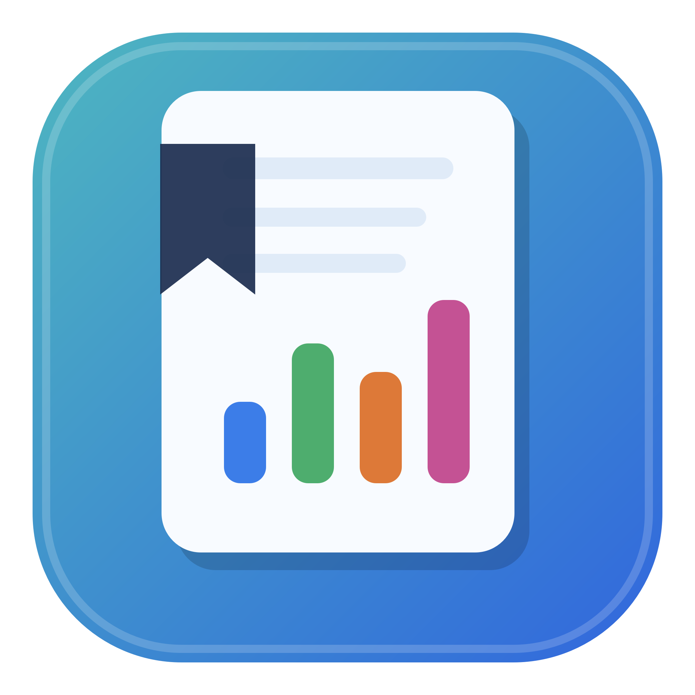

# Study Tracker



Study Tracker is a native macOS app for recording study sessions, reviewing how time is distributed across courses, setting study goals, and running focused timers. It works entirely on the Mac and does not require an account, cloud service, or external AI API.

## Contents

- [Requirements](#requirements)
- [Install the App](#install-the-app)
- [Quick Start](#quick-start)
- [Navigation](#navigation)
- [Classes and Course Planning](#classes-and-course-planning)
- [Logging Study Time](#logging-study-time)
- [Dashboard](#dashboard)
- [Goals](#goals)
- [Insights](#insights)
- [Weekly Review](#weekly-review)
- [Pomodoro Timer](#pomodoro-timer)
- [Archived Courses](#archived-courses)
- [Appearance and Settings](#appearance-and-settings)
- [Study Data and Backups](#study-data-and-backups)
- [Troubleshooting](#troubleshooting)
- [Privacy](#privacy)
- [Build from Source](#build-from-source)

## Requirements

The downloadable build currently requires:

- An Apple Silicon Mac
- macOS 14 or newer
- Permission to open an unsigned, unnotarized app

The app supports up to 50 active classes. Archived classes do not appear in the active class list and can be restored later.

## Install the App

1. Open the [Study Tracker releases page](https://github.com/Tomm-Rob/StudyTrackerMac/releases).
2. Open the newest release.
3. Download the macOS ARM64 ZIP file.
4. Double-click the ZIP to extract it.
5. Move `Study Tracker.app` into the Applications folder.
6. Open Study Tracker from Applications or add it to the Dock.

The repository is currently private. A GitHub account must be invited as a collaborator before it can view the repository or download a release.

### Opening the unsigned build

The downloadable app is ad-hoc signed, but it is not signed with an Apple Developer ID and has not been notarized. macOS may block the first launch.

Try these steps:

1. In Finder, open Applications.
2. Control-click or right-click `Study Tracker.app`.
3. Choose **Open**.
4. Confirm **Open** when macOS asks.

If that option is not available:

1. Try opening the app once.
2. Open **System Settings > Privacy & Security**.
3. Find the message about Study Tracker.
4. Choose **Open Anyway** and confirm.

Only bypass the warning when the app came from a person or repository you trust.

## Quick Start

1. Click **Add Class** at the bottom of the sidebar.
2. Rename the new class and choose its color.
3. Start the **Study Timer**, or enter an earlier session under **Add Study Session**.
4. Open **Dashboard** to review daily time and totals by class.
5. Add a goal from **Goals** or from the class page.
6. Use **Insights** and **Weekly Review** after several sessions have been recorded.

Changes are saved automatically.

## Navigation

The sidebar contains the main areas of the app:

| Area | Purpose |
| --- | --- |
| **Dashboard** | Customizable overview of totals, charts, goals, sessions, and insights |
| **Insights** | Date-filtered analytics, trends, consistency, and generated local observations |
| **Weekly Review** | A summary of one week with comparisons and suggested next-week targets |
| **Goals** | Daily, weekly, and course-specific goals |
| **Pomodoro** | Adjustable focus, short-break, and long-break timer |
| **Classes** | One detail page for each active class |
| **Archived Courses** | View and restore archived classes with their history |
| **Settings** | Appearance, save location, and chart-color controls |

Newly created classes appear at the top of the Classes section. Click the Classes header to collapse or expand the list.

Use the sidebar button near the top of the window, or the macOS **View** menu, to hide and restore the sidebar. The interface reflows as the window is resized.

## Classes and Course Planning

### Add a class

1. Click **Add Class** in the sidebar.
2. The app creates a class named **New Class** and opens its page.
3. Click the class name to rename it.
4. Use the color picker beside the name to choose its chart color.

Class colors are used in the dashboard bars, donut charts, legends, session rows, and leaderboard.

### Edit course details

Open a class and click **Edit**. Only the course name is required. Optional planning fields include:

- Course code
- Credit value
- Start date
- Target completion date
- Planned total study hours
- Weekly target hours
- Priority: Low, Normal, High, or Critical
- Status: Not Started, Active, Paused, or Completed
- Progress percentage from 0 to 100
- Completion date

Planned hours, weekly targets, priority, and dates make pacing and course analytics more useful. They are not required for basic time tracking.

### What appears on a class page

Each class page is focused on that class and includes:

- Total study time
- Number of sessions
- Average session length
- A live study timer
- Class-specific goals
- A daily study-time chart
- Manual session entry
- The class session history

The all-course charts and leaderboard remain on the main Dashboard.

## Logging Study Time

There are three ways to record study time.

### Use the live Study Timer

1. Open a class page, or add the **Study Timer** card to the Dashboard.
2. Select a class when using the Dashboard timer.
3. Click **Start**.
4. Click **Pause** to pause without losing elapsed time.
5. Click **Log** when the session is finished.
6. Review the completion sheet.
7. Confirm the class and choose **Completed Normally** or **Stopped Early**.
8. Optionally add a topic and focus, energy, and distraction ratings.
9. Choose **Save Session** or **Save Without Ratings**.

The reset button clears the unsaved timer.

### Enter a session manually

Use **Add Study Session** on a class page, or add the **Quick Log** card to the Dashboard.

1. Choose the class when needed.
2. Select the session date and time.
3. Set hours and minutes.
4. Optionally select a focus rating.
5. Click **Add**.

Manual entries are recorded with the **Manually Entered** completion state.

### Edit or delete a session

Sessions are listed newest first.

- Click the pencil button to edit the class, start time, duration, topic, ratings, or completion state.
- Click the trash button to delete a session.
- The **Recent Sessions** dashboard card also opens sessions for editing.

Deleting a session permanently removes it from totals, goals, charts, and analytics.

### Session ratings

Ratings are optional and use a 1-to-5 scale:

- **Focus:** Low to Excellent
- **Energy:** Low to Excellent
- **Distractions:** None to Constant

The app waits for enough rated sessions before presenting focus patterns as meaningful insights.

## Dashboard

The Dashboard is a responsive collection of cards. Its layout, card sizes, order, and visibility are saved automatically.

### Default cards

The default layout uses equal compact rectangles in up to three columns and includes:

- Total Study Time
- Daily Study Time
- Time by Class
- Leaderboard
- Local Insights
- Goals

Every card fills its assigned rectangle, even when it has little or no content. The Leaderboard opens in **Overall** mode, which includes archived courses and marks them with an archive icon. Use **Active** to show only current courses.

Additional cards available from the gallery include:

- Sessions
- Classes
- Study Timer
- Class Overview
- Quick Log
- Recent Sessions

### Change the date range

Use the outlined range menu at the top of the Dashboard to show 7, 14, 30, or 90 days in the daily bar chart.

### Read chart values

Move the pointer over:

- A daily bar to see its time in hours and minutes
- A colored part of a stacked bar to see that class and its time
- A donut segment to see the class and its total time

Tooltips follow the pointer and move around chart edges so neighboring cards do not cover them.

### Customize the Dashboard

1. Click **Edit Dashboard**.
2. Drag a card to another position, or use its left and right arrow buttons.
3. Click **Uniform Cards** to make all compatible visible cards equal compact rectangles.
4. Use the resize button to select a supported size.
5. Use the hide button to remove a card from the visible layout.
6. Click **Add Card** to restore a hidden card.
7. Click **Done** when finished.

The available sizes are Small, Medium, Large, Wide, and Extra Large. Each card only offers sizes that work with its content.

Use the reset button in Edit Dashboard mode to restore the default equal-card layout, sizes, and order. Uniform Cards is disabled when a visible functional card needs a larger size.

## Goals

Goals can be opened from the sidebar, the Dashboard Goals card, or the goals section on a class page.

### Add a goal

1. Open **Goals** and click **Add Goal**, or click the plus button in a goals card.
2. Choose a goal type.
3. Set the starting date.
4. Set the target hours and minutes.
5. For a course goal, select a class and optionally set a target date.
6. Click **Add Goal**.

Goal types:

- **Daily:** Study the target amount during each day.
- **Weekly:** Study the target amount during each calendar week.
- **Course:** Accumulate the target amount for one class from the selected start date.

### Understand goal progress

Goal cards show:

- Time studied
- Target time
- Completion percentage
- Completed, active, behind, or overdue status
- Course pacing when enough planning and session data exists
- Needed study time per day
- Recent daily pace
- Projected completion date when a projection is supported

Course projections use recent study activity. Missing or insufficient recent data is shown safely rather than producing a misleading estimate.

### Edit, archive, or restore a goal

- Open a goal card to edit it.
- Use **Archive** to remove it from active tracking without deleting it.
- Expand **Archived Goals** on the Goals page and click **Restore** to reactivate it.

## Insights

Insights updates all analytics for the selected date range. The default range is **Last 30 days**.

Available filters:

- Today
- This week
- This month
- Last 7 days
- Last 30 days
- This year
- All time
- Custom range

For a custom range, choose the **From** and **Through** dates. Both boundary dates are included.

### Summary metrics

The top section includes:

- Total study time
- Average time per active day
- Session count
- Active study days
- Average session length
- Longest session
- Completed Pomodoro intervals
- Current streak
- Longest streak

A streak is a sequence of calendar days with at least one valid study session.

### Course analytics

Course analytics can show:

- Total and percentage of time by class
- Average session length
- Session count
- Last studied date
- Progress toward planned total hours
- Weekly target progress
- Courses receiving less attention than their priority suggests

### Time and consistency patterns

The Insights page includes:

- Study time by weekday
- Study time by start time
- Morning, afternoon, evening, and night summaries
- Focus patterns by weekday and time window
- Average session duration by time window
- Most productive day and time window
- Days studied and percentage of days studied
- Calendar heatmap
- Weekly study-time trend
- Comparison with the previous equivalent period

Move the pointer over supported charts to see exact values.

### Local insights

Generated insights are deterministic rules calculated on the Mac. They may identify useful changes, neglected courses, concentration patterns, pacing, or time distributions.

The app intentionally suppresses claims when there is too little data. It does not use an online AI service.

## Weekly Review

Weekly Review summarizes one calendar week at a time.

It includes:

- Total study time
- Change from the previous week
- Active study days
- Current streak
- Average session duration
- Average focus rating when enough ratings exist
- Pomodoro intervals completed
- Goals completed and goals behind
- Most studied course
- Least studied active course
- Best study day
- Generated observations
- A suggested target for the next week

Use the left and right arrow buttons, date picker, or **This Week** to move between weeks.

Suggested targets are recommendations only. They never change an existing goal automatically.

## Pomodoro Timer

Open **Pomodoro** from the sidebar.

### Configure the timer

Use the steppers under **Timer Lengths** to set:

- Focus: 1 to 180 minutes
- Short Break: 1 to 60 minutes
- Long Break: 1 to 90 minutes

Settings are saved with the rest of the app data.

### Complete and log a focus round

1. Select **Focus**.
2. Choose the class under **Log To**.
3. Click **Start**.
4. Pause or reset when needed.
5. When the timer finishes, review and save the completion sheet.

A completed focus timer records one Pomodoro interval. After a saved focus round, the app selects a short break. Every fourth completed round selects a long break.

To stop early, click **Log Focus** after at least one minute. The completion sheet records it as stopped early and does not count it as a completed Pomodoro interval.

Break time is not logged as study time.

## Archived Courses

Archiving a course removes it from active navigation without deleting its sessions or analytics history.

To archive a course:

1. Open its class page.
2. Click **Archive**.
3. Confirm **Archive Class**.

To restore a course:

1. Open **Archived Courses**.
2. Find the course.
3. Click **Restore**.

The archive card shows the course's study time, session count, progress, and archive date. Restoration may be unavailable while 50 active classes already exist.

## Appearance and Settings

Open **Settings** from the sidebar.

### Appearance

Choose:

- **System:** Follow the Mac appearance
- **Light:** Use the crisp Studio Light theme
- **Dark:** Use the graphite-and-mint Graphite Focus theme

The app and Dock icon respond to the selected appearance.

### Data location

The current save-file path appears under **Data Location**.

- **Choose Folder** copies the current data into the selected folder and starts saving there.
- **Use Default** copies the current data back to the default Application Support folder and switches to it.

Choose a folder that is writable and remains available. Avoid moving or editing the active JSON file while Study Tracker is open.

### Chart colors

Class colors are changed from each class page. The Settings page also contains the app's daily bar graph color preference.

## Study Data and Backups

Study Tracker saves automatically to a local JSON file. No course or session data is stored in the GitHub repository or included in release downloads.

The default current file is:

```text
~/Library/Application Support/Study Tracker/study-tracker-data-v2.json
```

The app can import the legacy `study-tracker-data.json` file once when the protected current file does not yet exist. After import, older app builds cannot overwrite the protected file.

Migration backup files may appear in the same folder. Keep these files when troubleshooting or moving between versions.

### Make a manual backup

1. Open **Settings** and note the Data Location.
2. Quit Study Tracker.
3. Copy the current `study-tracker-data-v2.json` file to a safe folder.
4. Reopen the app.

To restore a manual backup, quit the app before replacing the current save file.

## Troubleshooting

### The app is blocked by macOS

Follow [Opening the unsigned build](#opening-the-unsigned-build). The release is not Developer ID signed or notarized.

### A chart or insight is empty

Confirm that sessions exist inside the selected date range. Focus analytics also require multiple rated sessions before they appear.

### A timer cannot be logged

Create at least one active class. The study timer requires elapsed time, and **Log Focus** requires at least one minute of focus time.

### A class disappeared

Open **Archived Courses**. Archived classes retain their study history and can be restored.

### The sidebar is hidden

Use the sidebar button near the top of the window or choose the sidebar command from the macOS **View** menu.

### The app reports that study data could not be opened

The app locks persistence and leaves the unreadable file unchanged. Do not create replacement data. Quit the app, preserve the file shown in Settings, and recover from a known-good backup.

### Data appears different in another copy of the app

Quit every running Study Tracker copy and use the final app in Applications. The current protected save file is `study-tracker-data-v2.json`.

## Privacy

- All calculations run locally.
- No account is required.
- No analytics or study data is uploaded.
- Generated insights do not use an external AI service.
- Changing the save folder is controlled by the user.
- Sharing the app or repository does not share the local study-data file.

## Build from Source

### Xcode

1. Clone the repository.
2. Open `Package.swift` in Xcode.
3. Select the **StudyTracker** scheme and **My Mac**.
4. Press Command-R to build and run.
5. Press Command-U to run tests.

### Terminal

Run the tests:

```sh
swift test
```

Build a release app and ZIP:

```sh
./scripts/package-app.sh
```

Generated files:

```text
dist/Study Tracker.app
dist/Study Tracker-1.0.0-macOS-arm64.zip
```

The packaging script creates an ad-hoc signed Apple Silicon build. Developer ID signing and Apple notarization are still required for a normal Gatekeeper-approved public distribution.

## License

No license has been added yet. Unless the repository owner states otherwise, the source code is not automatically granted an open-source license.
